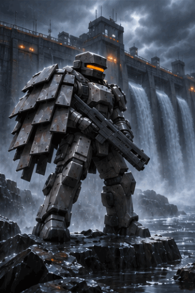
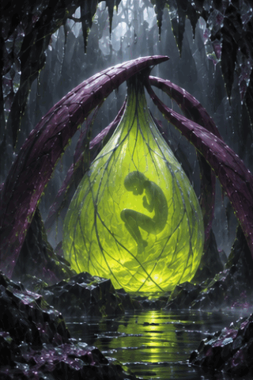
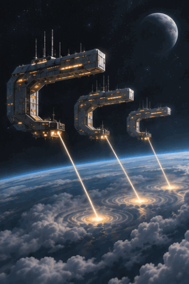
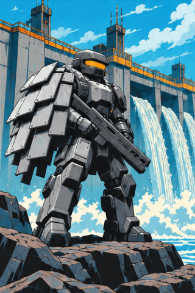
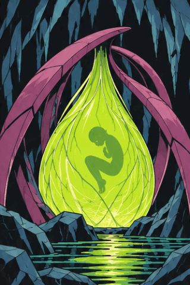
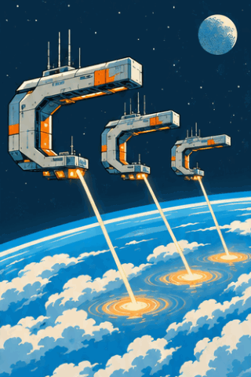
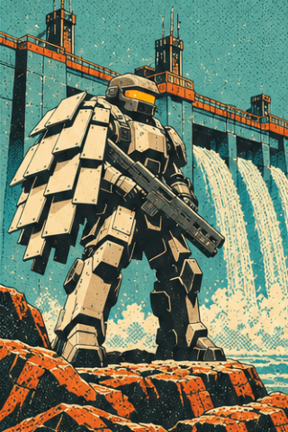
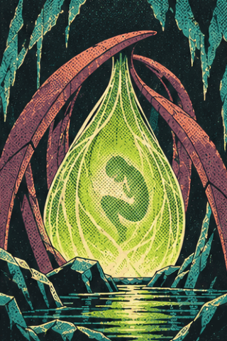
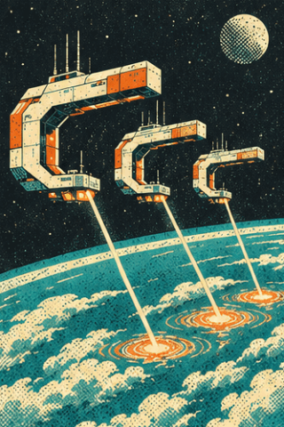

# Gatefall · пробы арта

Три карты в трёх стилях. Нажмите на иллюстрацию, чтобы открыть отдельный WebP (320 × 480).

| Стиль | Тяжёлый штурмовик | Кокон | Орбитальный залп |
| --- | --- | --- | --- |
| Мрачный sci-fi |  |  |  |
| Яркая стилизация |  |  |  |
| Ретрофутуристическая шелкография |  |  |  |
